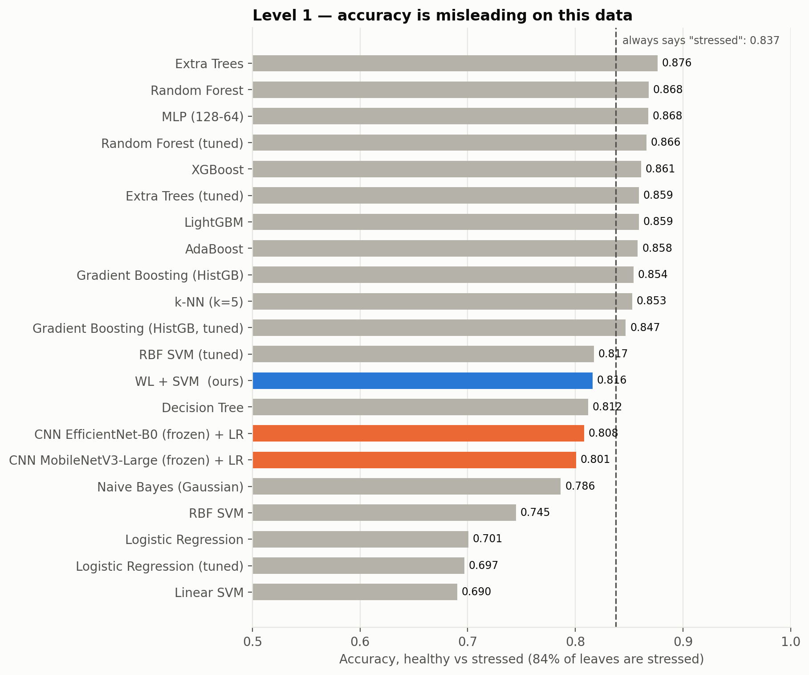
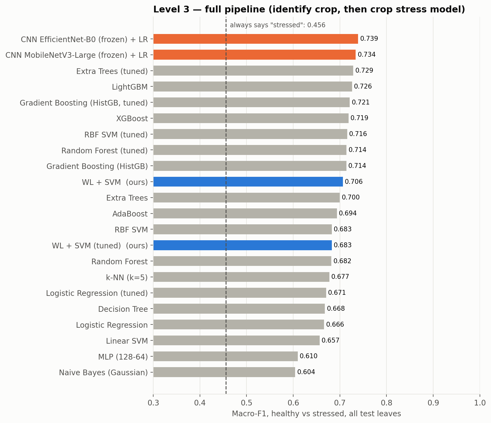
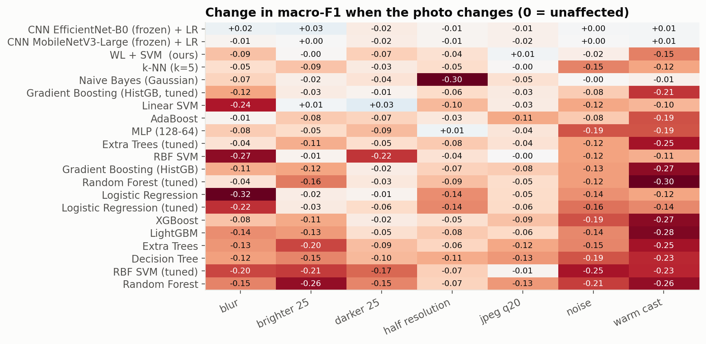
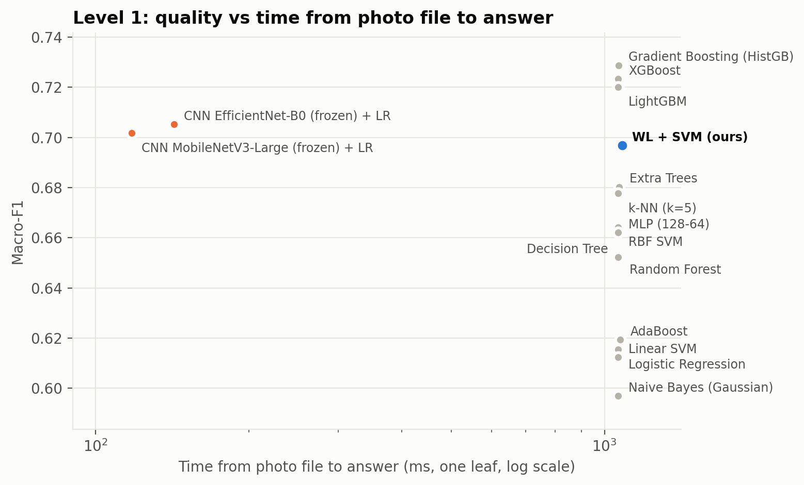
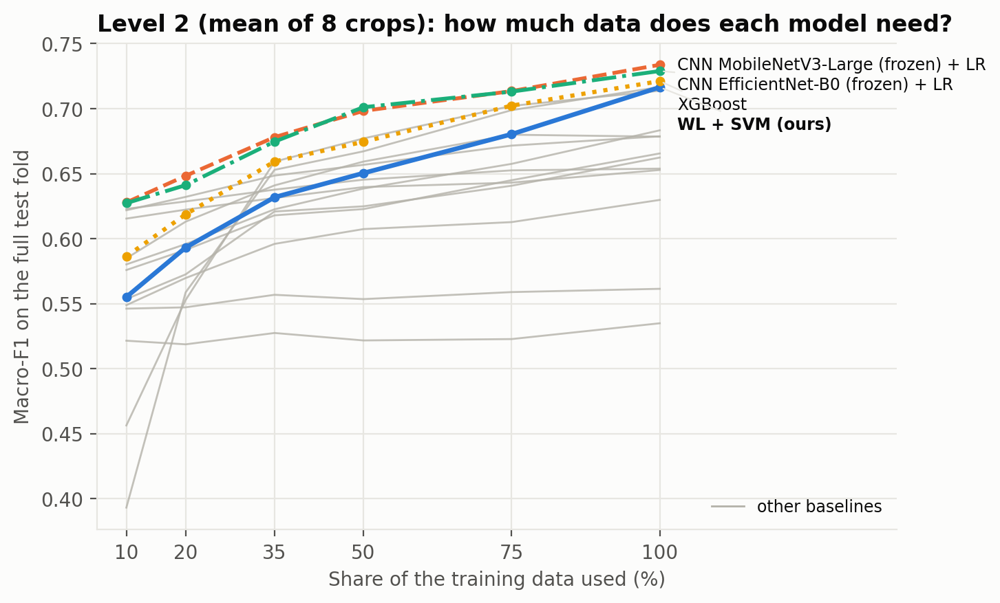

# 03 · Multi-dimensional baseline benchmark (final)

**Question:** Is the WL graph-kernel model better than standard models for plant-stress detection? We
measure it on several dimensions, not only accuracy: quality, speed, size, memory, data needs and
robustness to different photo conditions.

**Scope:** the main study is healthy-vs-stressed detection (Levels 1–3). The 57-class task
(crop × condition) is set aside as future work; its results are in the appendix of
[`results/REPORT_TABLES.md`](results/REPORT_TABLES.md).

All numbers are produced by the scripts in this folder and in `../04_CNN_Frozen_Features/`, and can be
regenerated (see **How to reproduce**).

---

## 1. Setup

| | |
|---|---|
| Data | 4,387 quality-accepted OLID-I leaves; 38 research measurements (`full_pipeline/olid_full_features.csv`); 84% of leaves are stressed |
| **Level 1** | healthy vs stressed, all crops in one model. Fixed folds `cv_fold_assignments.csv` (as NB21) |
| **Level 2** | healthy vs stressed, one model per crop. `StratifiedKFold(5, shuffle, 42)` per crop (as NB22) |
| **Level 3** | the full app pipeline: identify the crop (Random Forest, 300 trees), then use that crop's stress model. Fixed folds (as NB23) |
| WL + SVM | (a) the best research setting per task (NB21/NB22): slightly optimistic, because that setting was chosen on all data. (b) **tuned by nested CV** over graph type × WL depth inside each training fold: the fair version |
| Feature baselines | Logistic Regression, Linear SVM, RBF SVM, k-NN, Random Forest, Extra Trees, Gradient Boosting (HistGB), XGBoost, LightGBM, AdaBoost, Decision Tree, Naive Bayes, MLP; defaults, plus nested-CV **tuned** versions of the 5 strongest |
| CNN baselines | ImageNet-pretrained **MobileNetV3-Large** and **EfficientNet-B0**, frozen (not trained on OLID-I); logistic regression on their embeddings, regularisation tuned by nested CV (`../04_CNN_Frozen_Features`) |
| Fairness | same folds for every model; everything learned on the training fold only; one CPU core for training |

**Reproduction checks passed:** NB21 (Level 1 WL 0.6969), NB22 (e.g. cucumber WL 0.8521, RF 0.8038) and
NB23 (Level 3 WL with nested selection 0.6827 vs NB23's 0.6825) are reproduced. Re-extracting features
from the photos reproduces the research CSV exactly.

---

## 2. Why accuracy is not the headline metric

84% of the leaves are stressed, so a model that **always answers "stressed"** gets **83.8% accuracy**
while finding no healthy leaf at all. Several models reach high accuracy mostly this way (Random Forest
finds only 25% of healthy leaves). We therefore report **macro-F1** (main), **balanced accuracy**
and **specificity** (the share of healthy leaves found), and always show the "always stressed" line.



---

## 3. Results

### 3.1 Quality (macro-F1, healthy vs stressed)

| Model | Level 1 | Level 2 (mean of 8 crops) | **Level 3 (full pipeline)** |
|---|---|---|---|
| CNN EfficientNet-B0 (frozen) | 0.705 | 0.729 | **0.739** |
| CNN MobileNetV3-Large (frozen) | 0.702 | 0.734 | 0.734 |
| Extra Trees (tuned) | 0.722 | **0.742** | 0.729 |
| LightGBM | 0.720 | 0.714 | 0.726 |
| Gradient Boosting (tuned) | 0.728 | 0.727 | 0.721 |
| XGBoost | 0.723 | 0.721 | 0.719 |
| Gradient Boosting (default) | **0.729** | 0.717 | 0.714 |
| **WL + SVM, best research setting** | 0.697 | 0.716 | 0.706 |
| **WL + SVM, tuned (fair)** | n/a | 0.685 | 0.683 |
| Random Forest (default) | 0.653 | 0.662 | 0.682 |
| *Always "stressed" (reference)* | *0.456* | *0.455* | *0.456* |



**Reading:** WL is clearly better than the "always stressed" reference and than several standard
models (default Random Forest, Logistic Regression, Linear SVM, k-NN, Naive Bayes, MLP, Decision Tree).
It is **not** the most accurate: tuned tree ensembles, gradient boosting and the frozen CNNs score
0.02–0.05 higher. With fair (nested) tuning WL loses a further ~0.03, which shows that part of its earlier
advantage came from choosing its setting on all the data.

**Crop identification (Level 3 Stage 1):** Random Forest on the 38 measurements identifies the crop
correctly for 91.9% of leaves; the CNN embedding does so for **99.2%**. For WL, a wrong crop costs only
about 0.003 macro-F1 (oracle 0.709 vs 0.706).

**Finding healthy leaves (specificity, Level 3):** WL 57%, tuned Extra Trees 55%, CNNs 62–65%, default
Random Forest 31%, LightGBM 47%. Linear models and the RBF SVM find more (69–75%) but miss more
stressed leaves.

### 3.2 Robustness: photos taken differently

240 test photos changed 7 ways (darker, brighter, warm cast, blur, heavy JPEG, noise, half resolution),
changes applied at full size, then each model's normal pipeline.

| Model | Clean F1 | Mean F1 change | 95% CI |
|---|---|---|---|
| CNN EfficientNet-B0 | 0.705 | **+0.001** | [−0.027, +0.027] |
| CNN MobileNetV3-Large | 0.689 | **−0.006** | [−0.038, +0.021] |
| **WL + SVM** | 0.680 | **−0.053** | [−0.098, −0.009] |
| k-NN | 0.662 | −0.070 | |
| Gradient Boosting (tuned) | 0.718 | −0.075 | |
| Extra Trees (tuned) | 0.755 | −0.100 | |
| XGBoost / LightGBM | 0.750 / 0.760 | −0.117 / −0.126 | |
| Random Forest | 0.717 | −0.176 | |



* The frozen CNNs are essentially unaffected by these changes.
* **WL is the most robust feature-based model.** It loses significantly less than 9 feature models,
  including XGBoost, LightGBM, Random Forest, Extra Trees and tuned RBF SVM (bootstrap CIs exclude 0). It
  also loses less than the tuned tree ensembles (−0.075 to −0.113), but those differences are not significant.
* Why: WL uses only whether each measurement is Low, Medium or High, so small shifts in the measurements
  often do not change the graph. The feature pipeline as a whole is less robust than a CNN because the
  segmentation and colour measurements themselves move when lighting changes.

### 3.3 Speed, size, training

| | WL + SVM | Tree ensembles / boosting | Frozen CNN |
|---|---|---|---|
| **Photo → answer, one leaf** | ~1,080 ms | ~1,065–1,080 ms | **118–143 ms** |
| of which image processing | ~1,060 ms (full-size segmentation + 38 measurements) | same | 72–78 ms (read at 1/4 size, resize) |
| Model step | 18 ms | 2–8 ms | 39–70 ms (CNN) + < 1 ms |
| Model size (all 8 crop models) | 10.7 MB | 0.6–43 MB | 11.9–16.0 MB (one shared network + 8 small classifiers) |
| Training (8 crops, 1 core) | 1.1 s | 3–6 s (defaults), minutes (tuned) | seconds (classifier only; network not trained) |
| Peak training memory | 26 MB per crop, 392 MB for Level 1 (grows with n²) | < 6 MB | small (embeddings pre-computed) |

* End to end, the **frozen CNN is about 8× faster** than every feature-based model, because the research
  feature pipeline segments and measures the full 3,024 px photo. Speed is therefore not an argument for WL.
* WL's training memory grows with the square of the training set; this is its main scaling cost.



### 3.4 Data efficiency

| Level 2, macro-F1 with … of the training data | 10% | 20% | 50% | 100% |
|---|---|---|---|---|
| CNN MobileNetV3 | **0.628** | **0.648** | **0.698** | 0.734 |
| RBF SVM | 0.622 | 0.632 | 0.657 | 0.679 |
| XGBoost | 0.586 | 0.619 | 0.674 | 0.721 |
| WL + SVM | 0.555 | 0.593 | 0.650 | 0.716 |

WL needs more data than most models; it is still improving at 100%, so more labelled leaves would help it.



### 3.5 Explainability (qualitative)

| Model | What it can show for one leaf |
|---|---|
| **WL + SVM** | the leaf's feature graph, each measurement's Low/Medium/High level, which neighbourhood patterns are rare in training, and which training leaves pulled the answer each way, in terms of named, physical leaf measurements (shown live in the app) |
| Trees / boosting | global feature importance; per-leaf needs an extra tool (e.g. SHAP) |
| Frozen CNN | 960–1,280 abstract numbers; per-leaf needs saliency maps (e.g. Grad-CAM) that highlight pixels, not named measurements |

### 3.6 WL as a second opinion for the CNN (the hybrid)

Full pipeline, all 4,387 leaves in held-out folds (`results/hybrid_agreement_oof.csv`,
`results/hybrid_second_opinion_comparison.csv`). The CNN (EfficientNet-B0) decides; a second model checks.

| | Leaves | CNN correct | Macro-F1 |
|---|---|---|---|
| CNN and WL **agree** | 82.6% | **91.0%** | 0.799 |
| CNN and WL **disagree** | 17.4% | 55.8% | 0.541 |
| CNN alone | 100% | 84.8% | 0.739 |

* Disagreement flags 17.4% of leaves but contains **50.8% of all CNN mistakes**; flagging the CNN's
  least-confident 17.4% instead catches 44.1%. A measurement-based second opinion is a better warning than the
  CNN's own confidence.
* Not unique to WL: Extra Trees / LightGBM / Gradient Boosting as second opinion catch 53–59% at ~15% flagged.
  WL's distinguishing points are that its second opinion **explains itself in leaf terms** and is the **most
  stable** measurement-based model under photo changes (§3.2).

---

## 4. Honest conclusion: the trade-off

| If the priority is… | Best choice (measured) |
|---|---|
| Highest quality on the full pipeline, robustness to photo conditions, speed | **Frozen CNN** (EfficientNet-B0 / MobileNetV3): Level 3 0.739, unaffected by photo changes, ~120–140 ms per photo, 99% crop identification |
| Highest quality using only the 38 interpretable measurements | Tuned Extra Trees / gradient boosting (Level 2 up to 0.742) |
| An explanation in terms of named leaf measurements and their relations, with the most stable feature-based behaviour | **WL + SVM**: competitive (Level 3 0.706), the most robust feature-based model, structural explanation built in |
| Very small model / very little data | Logistic Regression / RBF SVM |

**Claims supported by the data:**
* WL graph kernels on handcrafted leaf measurements are competitive for stress detection: clearly above
  the trivial baseline and above several standard models.
* WL is the most robust feature-based model to changes in photo conditions.
* WL gives a structural, measurement-level explanation that the stronger models do not.

**Claims NOT supported (do not write):** WL is the most accurate model; WL is the fastest; WL beats CNNs;
WL is data-efficient; "~90% accuracy" as evidence of quality (83.8% is reached by always answering
"stressed").

**Suggested positioning for the report:** the research question is *how graph construction influences WL
kernels for plant-stress classification*. The benchmark shows where that approach stands: an
interpretable, structure-aware method that is competitive with classical models and more robust than them,
while pretrained CNN features remain stronger on raw performance. That is a legitimate and defensible
research result.

---

## 5. Files

| File | What |
|---|---|
| `bench.py` | shared protocol: data, splits, model zoo (defaults + nested-CV tuned), metrics, timing, size |
| `run_benchmark.py` | Levels 1, 2 (and 57-class appendix): quality, speed, size; `--models round2/tuned` |
| `run_level3.py` | Level 3, full pipeline (crop identification → crop stress model) |
| `run_learning_curves.py` | data efficiency (10–100% of training data) |
| `run_robustness.py` | `extract` (changed photos → measurements) and `evaluate` |
| `make_report.py` | tables, statistics (Friedman, Wilcoxon + Holm, bootstrap CIs), figures |
| `run_remaining.sh` | runs Level 3, the CNN steps, learning curves, robustness and the report in order |
| `../04_CNN_Frozen_Features/cnn_pipeline.py` | CNN baseline: photo cache, embeddings, all evaluations |
| `results/` | per-fold CSVs, summaries, statistics, `REPORT_TABLES.md` |
| `figures/` | report figures (PNG, 200 dpi) |

## How to reproduce (from this folder)

```bash
python run_benchmark.py level2 level1          # defaults (~10 min)
python run_benchmark.py level2 level1 --models round2
python run_benchmark.py level2 level1 --models tuned   # ~40 min
python run_learning_curves.py
python run_robustness.py extract 240 3          # ~15 min, needs ~2 GB free memory
bash run_remaining.sh                           # Level 3 + CNN + curves + robustness + report (~1.5 h)
```

Windows note: LightGBM must be imported before scikit-learn (`bench.py` does this); otherwise it crashes
with an access violation.

## Not yet done

* **CNN fine-tuning** (option B, ~6–8 h overnight): would likely raise the CNN's scores further.
* **57-class task** for the new models and the CNN (future work).
* The research paper's 57-class WL number (NB14: 0.391) uses an older labelling; with the corrected
  `feature::level` labels it is 0.423 (see appendix).
